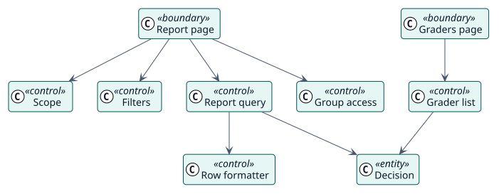

# Analysis

## Analysis classes

Stereotypes: `<<boundary>>` interface, `<<control>>` coordination, `<<entity>>` domain information.

| Class | Stereotype | Responsibility |
| --- | --- | --- |
| Report page, Graders page | boundary | The screens through which teachers and administrators read. |
| Scope | control | Tells the level of the report, its context and the capability it needs. |
| Filters | control | Reads the filters of the request and refuses a site report without one. |
| Report query | control | Reads the rows of a page from the decisions and the gradebook. |
| Group access | control | Limits the rows to the groups the reader can see. |
| Row formatter | control | Turns a row into status, date, grade and grader. |
| Grader list | control | Lists the teachers who could grade a course and a page of its students. |
| Decision | entity | The information that Autograder stored. |

## Use-case realizations

| ID | Use case | Collaboration |
| --- | --- | --- |
| UC-001 | [View the report of an activity or a course](./use-cases/viewReport/README.md) | [collaboration](./use-cases/viewReport/collaboration.svg) |
| UC-002 | [View the report of the site](./use-cases/viewSiteReport/README.md) | [collaboration](./use-cases/viewSiteReport/collaboration.svg) |
| UC-003 | [See who would grade each course](./use-cases/viewGraders/README.md) | [collaboration](./use-cases/viewGraders/collaboration.svg) |
