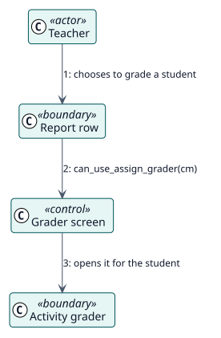

# UC-005 Grade a student from the report — analysis realization

| Overview | Requirements | Analysis | Design | Implementation | Tests |
| --- | --- | --- | --- | --- | --- |
| [Use cases](../../../requirements/use-case-overview.svg) | [Requirements](../../../requirements/use-cases/gradeFromReport/README.md) | **Analysis** | [Design](../../../design/use-cases/gradeFromReport/README.md) | [Implementation](../../../implementation/use-cases/gradeFromReport/README.md) | [Tests](../../../implementation/use-cases/gradeFromReport/README.md#tests) |

Requirements: [README](../../../requirements/use-cases/gradeFromReport/README.md)

## Participating classes

| Class | Stereotype | Responsibility |
| --- | --- | --- |
| Report row | boundary | Offers the action to grade. |
| Grader screen | control | Decides which grading screen the activity has. |
| Activity grader | boundary | The screen of the assignment or of the forum. |

## Collaboration

## Notes

Whatever the activity does when a teacher grades, such as notifying the student, still happens, because the grade is given in its own screen.
