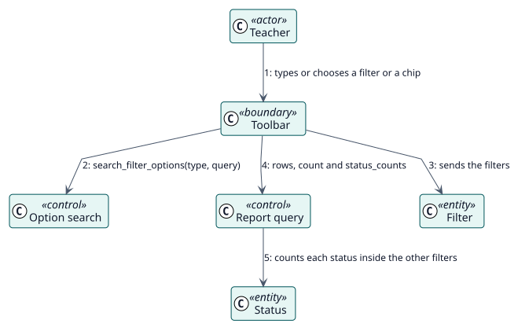

# UC-004 Narrow the report — analysis realization

| Overview | Requirements | Analysis | Design | Implementation | Tests |
| --- | --- | --- | --- | --- | --- |
| [Use cases](../../../requirements/use-case-overview.svg) | [Requirements](../../../requirements/use-cases/narrowReport/README.md) | **Analysis** | [Design](../../../design/use-cases/narrowReport/README.md) | [Implementation](../../../implementation/use-cases/narrowReport/README.md) | [Tests](../../../implementation/use-cases/narrowReport/README.md#tests) |

Requirements: [README](../../../requirements/use-cases/narrowReport/README.md)

## Participating classes

| Class | Stereotype | Responsibility |
| --- | --- | --- |
| Toolbar | boundary | Collects the search and the value of each filter menu, and clears one filter or all of them. |
| Option search | control | Lists the courses and activities the reader may see. |
| Report query | control | Counts the rows and each status inside the filters. |
| Filter | entity | What the report is narrowed to. |
| Status | entity | The state of a decision as the reader may see it. |

## Collaboration

## Notes

The counts are asked once for each set of filters and are not asked again when a page is turned.
