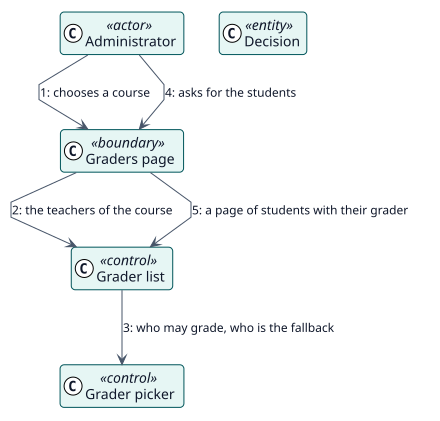

# UC-003 See who would grade each course — analysis realization

| Overview | Requirements | Analysis | Design | Implementation | Tests |
| --- | --- | --- | --- | --- | --- |
| [Use cases](../../../requirements/use-case-overview.svg) | [Requirements](../../../requirements/use-cases/viewGraders/README.md) | **Analysis** | [Design](../../../design/use-cases/viewGraders/README.md) | [Implementation](../../../implementation/use-cases/viewGraders/README.md) | [Tests](../../../implementation/use-cases/viewGraders/README.md#tests) |

Requirements: [README](../../../requirements/use-cases/viewGraders/README.md)

## Participating classes

| Class | Stereotype | Responsibility |
| --- | --- | --- |
| Graders page | boundary | Draws the teachers and the students. |
| Grader list | control | Lists the graders and a page of students. |
| Grader picker | control | Chooses the teacher of Autograder. |
| Decision | entity | What Autograder stored. |

## Collaboration

## Notes

The list works from the course; the report of an activity checks that activity before it shows the grader that applies.
