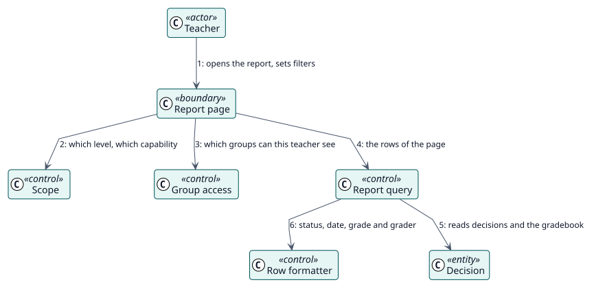

# UC-001 View the report of an activity or a course — analysis realization

| Overview | Requirements | Analysis | Design | Implementation | Tests |
| --- | --- | --- | --- | --- | --- |
| [Use cases](../../../requirements/use-case-overview.svg) | [Requirements](../../../requirements/use-cases/viewReport/README.md) | **Analysis** | [Design](../../../design/use-cases/viewReport/README.md) | [Implementation](../../../implementation/use-cases/viewReport/README.md) | [Tests](../../../implementation/use-cases/viewReport/README.md#tests) |

Requirements: [README](../../../requirements/use-cases/viewReport/README.md)

## Participating classes

| Class | Stereotype | Responsibility |
| --- | --- | --- |
| Report page | boundary | Draws the table, the filters and the pages. |
| Scope | control | Tells the level, the context and the capability. |
| Group access | control | Limits the rows to the groups of the reader. |
| Report query | control | Reads the rows of a page. |
| Row formatter | control | Builds status, date, grade and grader. |
| Decision | entity | What Autograder stored. |

## Collaboration

## Notes

The report reads only. Its three web-service functions are of type read and check the capability again.
