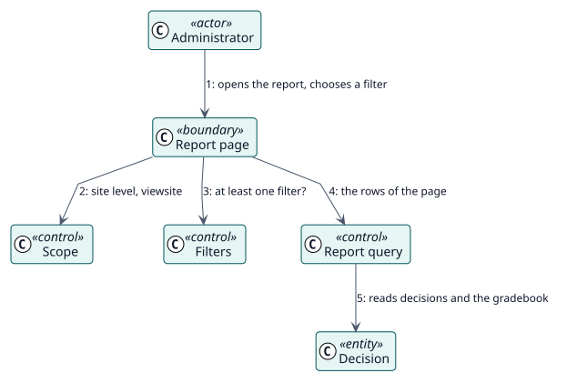

# UC-002 View the report of the site — analysis realization

| Overview | Requirements | Analysis | Design | Implementation | Tests |
| --- | --- | --- | --- | --- | --- |
| [Use cases](../../../requirements/use-case-overview.svg) | [Requirements](../../../requirements/use-cases/viewSiteReport/README.md) | **Analysis** | [Design](../../../design/use-cases/viewSiteReport/README.md) | [Implementation](../../../implementation/use-cases/viewSiteReport/README.md) | [Tests](../../../implementation/use-cases/viewSiteReport/README.md#tests) |

Requirements: [README](../../../requirements/use-cases/viewSiteReport/README.md)

## Participating classes

| Class | Stereotype | Responsibility |
| --- | --- | --- |
| Report page | boundary | Draws the filters and the table. |
| Scope | control | Tells the site level and its capability. |
| Filters | control | Refuses to run without a filter. |
| Report query | control | Reads the rows of a page. |
| Decision | entity | What Autograder stored. |

## Collaboration

## Notes

The filter bar offers the course and activity pickers through `report_autograder_search_filter_options`.
