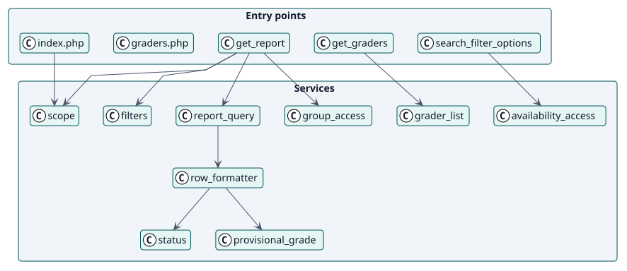
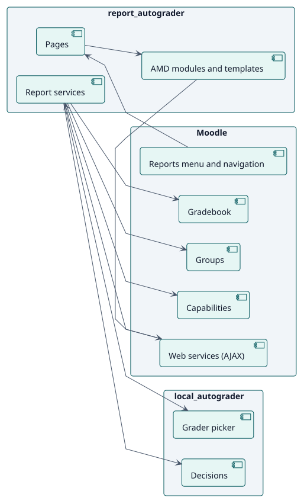
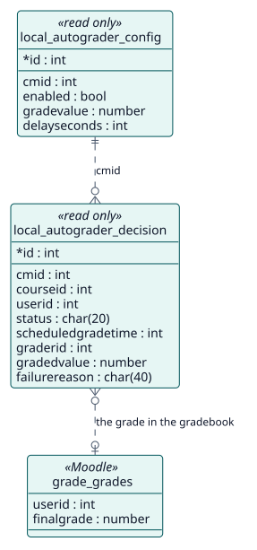

# Design

## Architecture

The Autograder report is a Moodle report plugin with three layers:

- **Entry points**: `index.php` and `graders.php`, which draw the page, two read-only web-service functions that feed its AMD modules, and the Mustache templates.
- **Services**: classes in `classes/local/`. `scope` and `filters` read the request, `report_query` reads the rows, `group_access` limits them, `row_formatter` turns them into words and `grader_list` lists the graders of a course.
- **Persistence**: none of its own. It reads the tables of Autograder and the gradebook.

Two decisions shape the design. First, **the capability is checked at each level and again in each web-service function**, so a page that is open cannot read more than its reader may. Second, **the report of the site never runs unfiltered**, so it cannot ask about every enrolment at once.

## Design classes

## Components

## Data model

The report adds no table: the model shows what it reads.

## Use-case realizations

| ID | Use case | Sequence |
| --- | --- | --- |
| UC-001 | [View the report of an activity or a course](./use-cases/viewReport/README.md) | [sequence](./use-cases/viewReport/sequence.svg) |
| UC-002 | [View the report of the site](./use-cases/viewSiteReport/README.md) | [sequence](./use-cases/viewSiteReport/sequence.svg) |
| UC-003 | [See who would grade each course](./use-cases/viewGraders/README.md) | [sequence](./use-cases/viewGraders/sequence.svg) |
| UC-004 | [Narrow the report](./use-cases/narrowReport/README.md) | [sequence](./use-cases/narrowReport/sequence.svg) |
| UC-005 | [Grade a student from the report](./use-cases/gradeFromReport/README.md) | [sequence](./use-cases/gradeFromReport/sequence.svg) |
