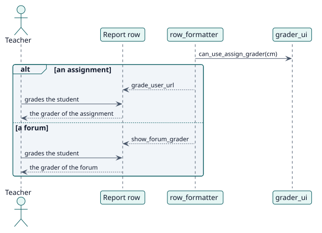

# UC-005 Grade a student from the report — design realization

| Overview | Requirements | Analysis | Design | Implementation | Tests |
| --- | --- | --- | --- | --- | --- |
| [Use cases](../../../requirements/use-case-overview.svg) | [Requirements](../../../requirements/use-cases/gradeFromReport/README.md) | [Analysis](../../../analysis/use-cases/gradeFromReport/README.md) | **Design** | [Implementation](../../../implementation/use-cases/gradeFromReport/README.md) | [Tests](../../../implementation/use-cases/gradeFromReport/README.md#tests) |

Analysis: [README](../../../analysis/use-cases/gradeFromReport/README.md)

## Elements

| Design element | Kind | Code target |
| --- | --- | --- |
| `grader_ui::can_use_assign_grader` | service | `classes/local/page/grader_ui.php:94` |
| `grader_ui::get_forum_grade_context` | service | `classes/local/page/grader_ui.php:52` |
| `row_formatter::add_grading_action` | service | `classes/local/format/row_formatter.php` |

## Sequence

## Contracts

| Operation | Input | Output | Errors |
| --- | --- | --- | --- |
| `get_report` row | the activity and the student | `grade_user_url` or `show_forum_grader` | none |

## Data touched

| Table or entity | Operation |
| --- | --- |
| No table | none: it only hands over |
