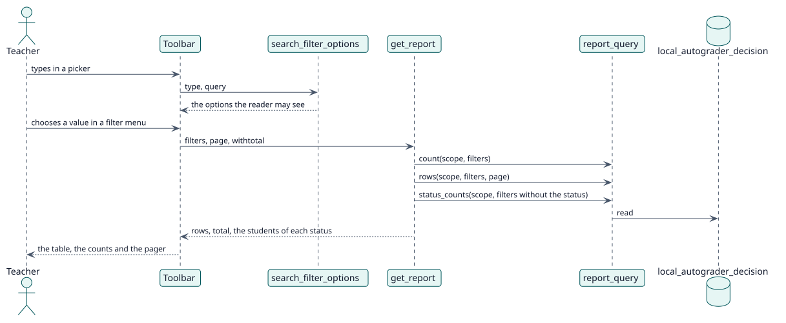

# UC-004 Narrow the report — design realization

| Overview | Requirements | Analysis | Design | Implementation | Tests |
| --- | --- | --- | --- | --- | --- |
| [Use cases](../../../requirements/use-case-overview.svg) | [Requirements](../../../requirements/use-cases/narrowReport/README.md) | [Analysis](../../../analysis/use-cases/narrowReport/README.md) | **Design** | [Implementation](../../../implementation/use-cases/narrowReport/README.md) | [Tests](../../../implementation/use-cases/narrowReport/README.md#tests) |

Analysis: [README](../../../analysis/use-cases/narrowReport/README.md)

## Elements

| Design element | Kind | Code target |
| --- | --- | --- |
| `get_report::execute` | web service | `classes/external/get_report.php:93` |
| `filters::from_request` | service | `classes/local/query/filters.php:63` |
| `filters::without_statuses` | service | `classes/local/query/filters.php:172` |
| `report_query::status_counts` | service | `classes/local/query/report_query.php:77` |
| `search_filter_options::execute` | web service | `classes/external/search_filter_options.php:109` |
| `page_context::filters` | service | `classes/local/page/page_context.php:51` |

## Sequence

## Contracts

| Operation | Input | Output | Errors |
| --- | --- | --- | --- |
| `report_autograder_search_filter_options(type, query, cmid, courseid, filtercourseid)` | what is searched and the report it belongs to | up to thirty options | no capability |
| `report_autograder_get_report(..., filters, withtotal)` | the filters | the rows, the total and `statuscounts` | no capability, invalid filter |

## Data touched

| Table or entity | Operation |
| --- | --- |
| `local_autograder_decision` | read |
| `local_autograder_config` | read |
