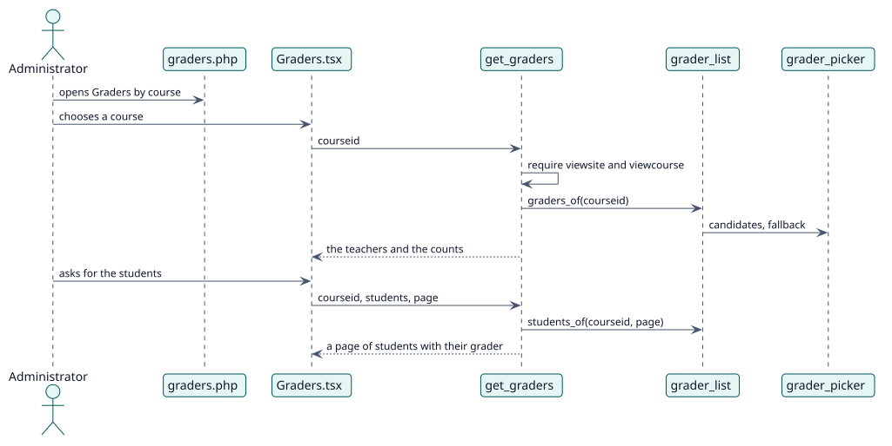

# UC-003 See who would grade each course — design realization

| Overview | Requirements | Analysis | Design | Implementation | Tests |
| --- | --- | --- | --- | --- | --- |
| [Use cases](../../../requirements/use-case-overview.svg) | [Requirements](../../../requirements/use-cases/viewGraders/README.md) | [Analysis](../../../analysis/use-cases/viewGraders/README.md) | **Design** | [Implementation](../../../implementation/use-cases/viewGraders/README.md) | [Tests](../../../implementation/use-cases/viewGraders/README.md#tests) |

Analysis: [README](../../../analysis/use-cases/viewGraders/README.md)

## Elements

| Design element | Kind | Code target |
| --- | --- | --- |
| `get_graders::execute` | service | `classes/external/get_graders.php:63` |
| `grader_list::graders_of` | service | `classes/local/page/grader_list.php:66` |
| `grader_list::students_of` | service | `classes/local/page/grader_list.php:103` |

## Sequence

## Contracts

| Operation | Input | Output | Errors |
| --- | --- | --- | --- |
| `report_autograder_get_graders(courseid, students, page, perpage)` | the course and, when asked, a page of students | the graders, the counts and the students | no capability, course not found |

## Data touched

| Table or entity | Operation |
| --- | --- |
| `local_autograder_decision` | read |
| `user_enrolments` | read |
