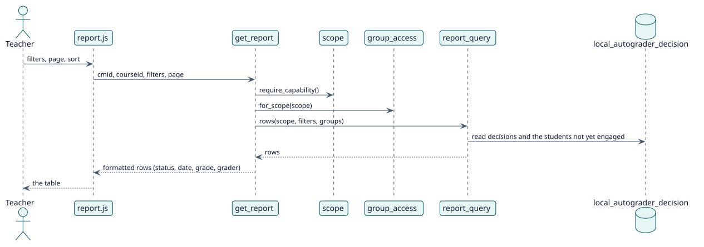

# UC-001 View the report of an activity or a course — design realization

| Overview | Requirements | Analysis | Design | Implementation | Tests |
| --- | --- | --- | --- | --- | --- |
| [Use cases](../../../requirements/use-case-overview.svg) | [Requirements](../../../requirements/use-cases/viewReport/README.md) | [Analysis](../../../analysis/use-cases/viewReport/README.md) | **Design** | [Implementation](../../../implementation/use-cases/viewReport/README.md) | [Tests](../../../implementation/use-cases/viewReport/README.md#tests) |

Analysis: [README](../../../analysis/use-cases/viewReport/README.md)

## Elements

| Design element | Kind | Code target |
| --- | --- | --- |
| `get_report::execute` | service | `classes/external/get_report.php:97` |
| `scope::require_capability` | service | `classes/local/query/scope.php:160` |
| `report_query::rows` | service | `classes/local/query/report_query.php:106` |
| `report_query::status_counts` | service | `classes/local/query/report_query.php:77` |
| `group_access::for_scope` | service | `classes/local/groups/group_access.php:100` |
| `status::from_decision` | service | `classes/local/format/status.php:64` |

## Sequence

## Contracts

| Operation | Input | Output | Errors |
| --- | --- | --- | --- |
| `report_autograder_get_report(cmid, courseid, page, limit, filters, sortcolumn, sortdir, withtotal)` | the level, the filters, the page and the sort | one page of formatted rows, the total and the students of each status | no capability, invalid filter |

## Data touched

| Table or entity | Operation |
| --- | --- |
| `local_autograder_decision` | read |
| `local_autograder_config` | read |
| `grade_grades` | read |
