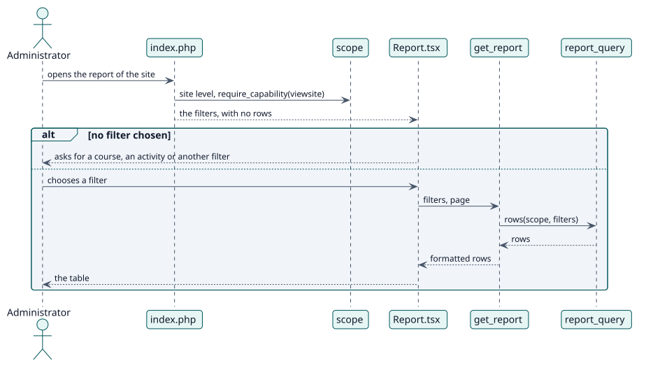

# UC-002 View the report of the site — design realization

| Overview | Requirements | Analysis | Design | Implementation | Tests |
| --- | --- | --- | --- | --- | --- |
| [Use cases](../../../requirements/use-case-overview.svg) | [Requirements](../../../requirements/use-cases/viewSiteReport/README.md) | [Analysis](../../../analysis/use-cases/viewSiteReport/README.md) | **Design** | [Implementation](../../../implementation/use-cases/viewSiteReport/README.md) | [Tests](../../../implementation/use-cases/viewSiteReport/README.md#tests) |

Analysis: [README](../../../analysis/use-cases/viewSiteReport/README.md)

## Elements

| Design element | Kind | Code target |
| --- | --- | --- |
| `scope::from_params` | service | `classes/local/query/scope.php:77` |
| `filters` | service | `classes/local/query/filters.php` |
| `search_filter_options::execute` | service | `classes/external/search_filter_options.php:109` |

## Sequence

## Contracts

| Operation | Input | Output | Errors |
| --- | --- | --- | --- |
| `report_autograder_search_filter_options(type, query, cmid, courseid, filtercourseid)` | the type of picker and what the reader typed | the matching courses or activities | no capability |

## Data touched

| Table or entity | Operation |
| --- | --- |
| `local_autograder_decision` | read |
| `course` | read (the picker) |
