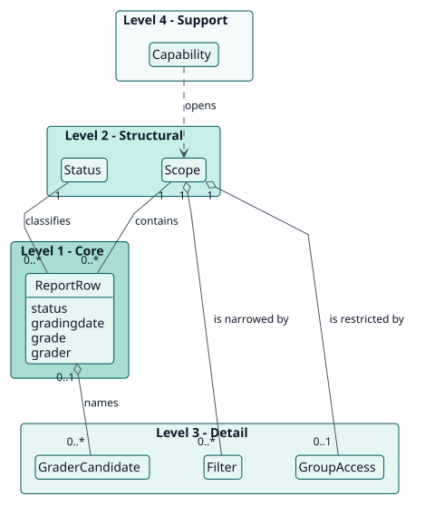
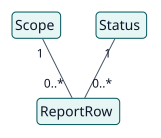
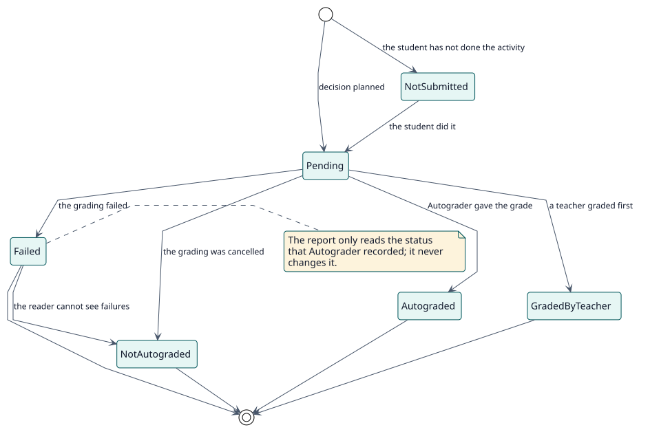

# Domain model

## Purpose

Autograder decides and grades; this plugin lets people see what was decided. Its model names what a reader sees: one row per student and autograded activity, the level at which they read it and the status that classifies each row.

## Hierarchy of entities

The vertical position of an entity expresses its importance to the project objective. It is not UML inheritance or composition.

| Level | Meaning | Entities | Why they are here |
| --- | --- | --- | --- |
| 1 | Core: the project cannot exist without them | ReportRow | The plugin exists to show, for a student and an activity, the status, the date, the grade and the grader. |
| 2 | Structural: depend directly on the core | Scope, Status | A row belongs to a level of reading and has a status. |
| 3 | Detail: qualify or specialise level 2 | Filter, GroupAccess, GraderCandidate | They narrow what a reader sees and name who would grade. |
| 4 | Support: catalogues, audit, configuration | Capability | It decides who may read each level. |

## Diagrams

## Entity dictionary

| Entity | Level | Definition | Key attributes | Omitted attributes and why |
| --- | --- | --- | --- | --- |
| ReportRow | 1 | One student in one autograded activity, as the reader sees it. | status, grading date, grade, grader | It is not stored: it is built from the decisions of Autograder and the gradebook. |
| Scope | 2 | The level at which the report is read: activity, course or site. | level, activity, course | It is calculated from the address of the page. |
| Status | 2 | What the row says about the student: pending, autograded, graded by a teacher, failed, not autograded or not submitted. | the status | It is the status that Autograder recorded, translated into words for teachers. |
| Filter | 3 | A narrowing of the table: a search text, a period, statuses, a course, an activity or a group. | name, value | |
| GroupAccess | 3 | The groups a teacher can see in an activity with separate groups. | group ids | It follows Moodle's own rules for groups. |
| GraderCandidate | 3 | A teacher who could grade a course, or the fallback grader. | Moodle user | It is computed by Autograder. |
| Capability | 4 | The permission to read a level or to see failures. | the capability | They are defined in `db/access.php`. |

## Business rules

| ID | Rule | Entities | Source |
| --- | --- | --- | --- |
| RN-001 | There is one row per student and autograded activity; a student who has not done the activity appears as not submitted. | ReportRow, Status | `report_query::rows` |
| RN-002 | The report of the site does not run without a filter, so it never asks about every enrolment of the site at once. | Scope, Filter | `classes/local/query/filters.php` |
| RN-003 | Failed gradings and their reasons are shown only to readers who can see failures; the others see those students as not autograded. | Status, Capability | `status::from_decision`, `scope::can_see_failures` |
| RN-004 | A teacher sees only the students of the groups they can see in the activity. | GroupAccess | `group_access::for_scope` |
| RN-005 | A pending row shows the grade the student would receive and the teacher who would sign it if it were given now. | ReportRow, GraderCandidate | `provisional_grade::for_row` |
| RN-006 | The report only reads: it never grades, cancels or changes a decision. | all | read-only web services |
| RN-007 | A student that the access restrictions of the activity leave out is not listed as not submitted: they cannot open the activity, so the report says nothing about them. | ReportRow, Scope | `availability_access::for_scope` |
| RN-008 | The count of each status is computed inside every other filter except the status, so that choosing a status does not hide the numbers of the others. | Filter, Status | `report_query::status_counts` |
| RN-009 | The pager offers only the sizes of page smaller than the list, and All: up to 12 rows, All; 13 to 24, 12 and All; and so on up to 12, 24, 48, 96 and All. A list starts with 12 rows; All is sent to the services as -1, which they cap. | Filter | `amd/src/ui/pagination.js`, `get_report::normalise_limit`, `grader_list::page_size` |
| RN-010 | Each filter is a menu that never offers its base state as an option; once a value is chosen, the menu is highlighted and a cross takes the place of its arrow to clear it. A button at the end of the row clears every filter. | Filter | `amd/src/ui/toolbar.js` |
| RN-011 | The first time a person opens the report of an activity or of a course, a guided tour presents it; when the site requires it, the tour cannot be skipped before its last step. | Scope | `tours/report.json`, `report_autograder_import_tours`, `report_autograder/tourrequired` |
| RN-012 | The button that opens the details of a row takes the colour of the most serious thing in them: information, a problem that can still be solved, or a failed grading. A grade that is not in the gradebook yet carries the label Provisional, and a row without a grade shows a dash. | ReportRow | `templates/table/_row.mustache`, `templates/table/row_details.mustache`, `amd/src/ui/report.js` |
| RN-013 | The columns of the table keep the width they had the first time the table had rows; a filter, a sort or another page never moves them. They are measured again only when the box of the table changes width. | ReportRow | `amd/src/ui/report.js` |
| RN-014 | The row of filters is never split in two lines: when the menus do not fit beside the search (10 rem), they are gathered in one menu, Filters, with the number of filters in use, and they come apart again when there is room. | Filter | `amd/src/ui/toolbar.js` |

## Lifecycles

### Status of a row

