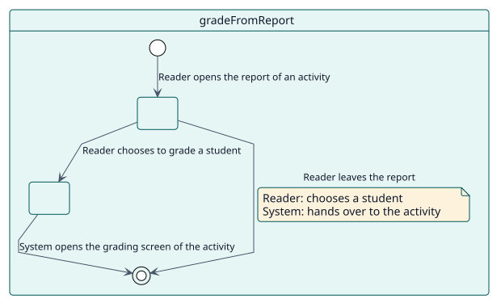
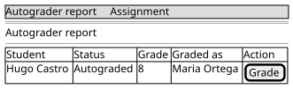

# UC-005 Grade a student from the report

| Overview | Requirements | Analysis | Design | Implementation | Tests |
| --- | --- | --- | --- | --- | --- |
| [Use cases](../../use-case-overview.svg) | **Requirements** | [Analysis](../../../analysis/use-cases/gradeFromReport/README.md) | [Design](../../../design/use-cases/gradeFromReport/README.md) | [Implementation](../../../implementation/use-cases/gradeFromReport/README.md) | [Tests](../../../implementation/use-cases/gradeFromReport/README.md#tests) |

## Use-case information

| Field | Value |
| --- | --- |
| Actor | Teacher |
| Package | Reading |
| Goal | Go from a row of the report to the grading screen that the activity already has for that student. |
| Type | Primary, essential |
| Level | User goal |
| Requirement | RF-006 |
| Domain entities | ReportRow, Scope |

## Context

The report never grades. Where a teacher wants to grade a student they are looking at, the row sends them to the screen of the activity, so that everything the activity does around a grade still happens.

## Preconditions

- The reader opened the report of one activity, which is an assignment or a forum.

## Postconditions

- Success: the grading screen of the activity opens on that student.
- Failure: the row offers no grading action.

## Main flow

| Step | Actor | System |
| --- | --- | --- |
| 1 | Opens the report of an activity. | Gives each row the way to grade it that the type of the activity allows. |
| 2 | Chooses to grade the student of a row. | For an assignment, goes to its grader by address; for a forum, opens the grader of the forum. |

## Alternative flows

| ID | Starts at step | Condition | Behaviour | Ends |
| --- | --- | --- | --- | --- |
| A1 | 1 | The report is the one of a course or of the site. | Offers no grading action: the screens are launched from the report of the activity. | End |
| A2 | 1 | The activity is of another type. | Offers no grading action. | End |

## Business rules

| ID | Rule |
| --- | --- |
| RN-006 | The report only reads: it never grades, cancels or changes a decision. |

## Specification

Behaviour source of truth: [specification.puml](./specification.puml)

## Wireframes

