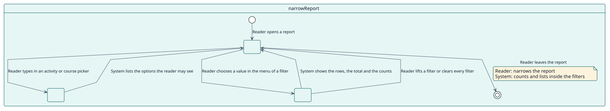
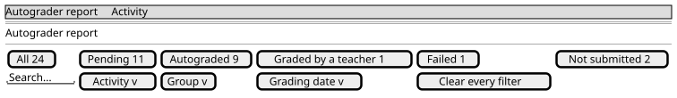

# UC-004 Narrow the report

| Overview | Requirements | Analysis | Design | Implementation | Tests |
| --- | --- | --- | --- | --- | --- |
| [Use cases](../../use-case-overview.svg) | **Requirements** | [Analysis](../../../analysis/use-cases/narrowReport/README.md) | [Design](../../../design/use-cases/narrowReport/README.md) | [Implementation](../../../implementation/use-cases/narrowReport/README.md) | [Tests](../../../implementation/use-cases/narrowReport/README.md#tests) |

## Use-case information

| Field | Value |
| --- | --- |
| Actor | Teacher, Administrator |
| Package | Reading |
| Goal | Find the students that matter in the report by name, status, group, grading date, activity or course. |
| Type | Primary, essential |
| Level | User goal |
| Requirement | RF-005 |
| Domain entities | Filter, Status, ReportRow, GroupAccess |

## Context

A report can list thousands of rows. The toolbar narrows it with the search and one menu for each filter; the menu of the statuses shows how many students are in each status, counted inside every other filter, so that the numbers add up to the rows the report would show.

## Preconditions

- The reader has opened a report and holds its capability.

## Postconditions

- Success: the table shows the students that match, with the total and the number of each status.
- Failure: a filter that is not valid is ignored and the report keeps what it showed.

## Main flow

| Step | Actor | System |
| --- | --- | --- |
| 1 | Types a name, or chooses in their menus one or more statuses, a group, a period of grading dates, an activity or a course. | For the activity and the course, searches the options as the reader types, among the ones the reader may see. |
| 2 |  | Asks for the first page again with the filters, the total and the students of each status. |
| 3 |  | Shows the rows, the total and the count of each status, highlights the menus that narrow the report and puts a cross in place of their arrow. |
| 4 | Presses the cross of a menu, or the button that clears every filter. | Lifts that filter, or every filter, and shows the report again from its first page. |

## Alternative flows

| ID | Starts at step | Condition | Behaviour | Ends |
| --- | --- | --- | --- | --- |
| A1 | 2 | The report is the one of the site and the reader has not narrowed it. | Asks for a filter before it runs. | Step 1 |
| A2 | 2 | The reader cannot see failures. | Offers no status of failed students and counts them as not autograded. | Step 3 |
| A3 | 3 | A status has no students. | Offers it with a count of zero. | Step 4 |

## Business rules

| ID | Rule |
| --- | --- |
| RN-008 | The count of each status is computed inside every other filter except the status, so that choosing a status does not hide the numbers of the others. |
| RN-009 | The pager offers only the sizes of page smaller than the list, and All: up to 12 rows, All; 13 to 24, 12 and All; and so on up to 12, 24, 48, 96 and All. A list starts with 12 rows; All is sent to the services as -1, which they cap. |
| RN-010 | Each filter is a menu that never offers its base state as an option; once a value is chosen, the menu is highlighted and a cross takes the place of its arrow to clear it. A button at the end of the row clears every filter. A chosen menu shows only its value, or the name of the filter and how many values are chosen. |
| RN-014 | The row of filters is never split in two lines: when the menus do not fit beside the search (10 rem), they are gathered in one menu, Filters, with the funnel icon and the number of filters in use, and they come apart again when there is room. A long value is cut with an ellipsis before the cross of its menu. |
| RN-002 | The report of the site does not run without a filter. |
| RN-003 | Failures are shown only to readers who can see them. |
| RN-004 | A teacher sees only the groups they can see. |

## Specification

Behaviour source of truth: [specification.puml](./specification.puml)

## Wireframes

