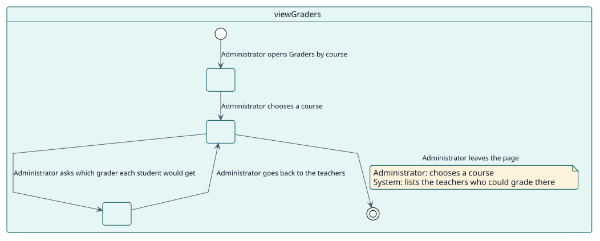

# UC-003 See who would grade each course

| Overview | Requirements | Analysis | Design | Implementation | Tests |
| --- | --- | --- | --- | --- | --- |
| [Use cases](../../use-case-overview.svg) | **Requirements** | [Analysis](../../../analysis/use-cases/viewGraders/README.md) | [Design](../../../design/use-cases/viewGraders/README.md) | [Implementation](../../../implementation/use-cases/viewGraders/README.md) | [Tests](../../../implementation/use-cases/viewGraders/README.md#tests) |

## Use-case information

| Field | Value |
| --- | --- |
| Actor | Administrator |
| Package | Reading |
| Goal | Know, before any grade is due, which teacher would grade each student of a course. |
| Type | Primary, essential |
| Level | User goal |
| Requirement | RF-003 |
| Domain entities | GraderCandidate, ReportRow, Scope |

## Context

A course where nobody is allowed to grade would fail every grade when its date arrives. The page of the graders shows who could grade there, so it can be fixed in advance.

## Preconditions

- The administrator holds `report/autograder:viewsite`, and `report/autograder:viewcourse` in the course.

## Postconditions

- Success: the teachers who could grade are listed, with the fallback grader, and a page of students shows the grader each would get.
- Failure: the page refuses to show a course the administrator cannot read.

## Main flow

| Step | Actor | System |
| --- | --- | --- |
| 1 | Opens **Graders by course** and chooses a course. | Checks both capabilities. |
| 2 |  | Lists the teachers who could grade there and counts them and the students. |
| 3 | Asks which grader each student would get. | Reads a page of students with the teacher chosen for each. |

## Alternative flows

| ID | Starts at step | Condition | Behaviour | Ends |
| --- | --- | --- | --- | --- |
| A1 | 2 | Nobody could grade in the course. | Flags the course; every grade there would fail without a fallback grader. | Step 3 |

## Business rules

| ID | Rule |
| --- | --- |
| RN-005 | A row shows the teacher who would sign the grade if it were given now. |
| RN-006 | The page only reads. |

## Specification

Behaviour source of truth: [specification.puml](./specification.puml)

## Wireframes

