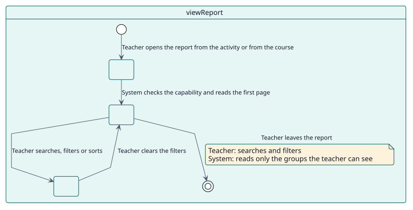
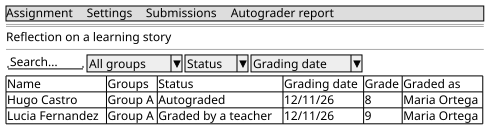

# UC-001 View the report of an activity or a course

| Overview | Requirements | Analysis | Design | Implementation | Tests |
| --- | --- | --- | --- | --- | --- |
| [Use cases](../../use-case-overview.svg) | **Requirements** | [Analysis](../../../analysis/use-cases/viewReport/README.md) | [Design](../../../design/use-cases/viewReport/README.md) | [Implementation](../../../implementation/use-cases/viewReport/README.md) | [Tests](../../../implementation/use-cases/viewReport/README.md#tests) |

## Use-case information

| Field | Value |
| --- | --- |
| Actor | Teacher |
| Package | Reading |
| Goal | Follow the students of an activity or of a course and know who is waiting. |
| Type | Primary, essential |
| Level | User goal |
| Requirement | RF-001 |
| Domain entities | ReportRow, Scope, Status, Filter, GroupAccess |

## Context

A teacher needs to see, for each student, what Autograder decided: the status, the grading date, the grade and who signs it. The report appears where the teacher already works, in the menu of the activity or of the course.

## Preconditions

- The teacher holds `report/autograder:view` in the activity, or `report/autograder:viewcourse` in the course.
- Autograder is enabled in the activity, or in at least one activity of the course.

## Postconditions

- Success: the table shows the students the teacher may see, narrowed by what the teacher chose.
- Failure: the page refuses to open without the capability.

## Main flow

| Step | Actor | System |
| --- | --- | --- |
| 1 | Opens **Autograder report** in the menu of the activity or of the course. | Checks the capability of the level. |
| 2 |  | Reads the first page of rows, limited to the groups the teacher can see. |
| 3 | Searches, filters or sorts. | Reads the page again with the new filters. |
| 4 |  | Shows each row with its status, date, grade and grader; a pending row shows the grade and the teacher it would have now; above the rows, the menu of the statuses shows how many students are in each, counted inside the other filters; under them, the pager offers the sizes of page that fit the list. |

## Alternative flows

| ID | Starts at step | Condition | Behaviour | Ends |
| --- | --- | --- | --- | --- |
| A1 | 1 | The teacher has no capability. | Refuses the page. | End |
| A2 | 2 | The activity has separate groups. | Leaves out the students of groups the teacher cannot see. | Step 3 |
| A3 | 4 | The reader cannot see failures. | Shows a failed student as not autograded. | Step 3 |
| A4 | 1 | It is the first time the reader opens the report of an activity or of a course. | Presents the report with a guided tour of seven steps; when the site requires the tour, it has no button to skip it before its last step. | Step 2 |

## Business rules

| ID | Rule |
| --- | --- |
| RN-001 | There is one row per student and autograded activity. |
| RN-003 | Failures are shown only to readers who can see them. |
| RN-004 | A teacher sees only the groups they can see. |
| RN-005 | A pending row shows the provisional grade and grader. |
| RN-007 | A student that the access restrictions of the activity leave out is not listed as not submitted: they cannot open the activity, so the report says nothing about them. |
| RN-009 | The pager offers only the sizes of page smaller than the list, and All: up to 12 rows, All; 13 to 24, 12 and All; and so on up to 12, 24, 48, 96 and All. A list starts with 12 rows; All is sent to the services as -1, which they cap. |
| RN-011 | The first time a person opens the report of an activity or of a course, a guided tour presents it; when the site requires it, the tour cannot be skipped before its last step. |

## Specification

Behaviour source of truth: [specification.puml](./specification.puml)

## Wireframes

