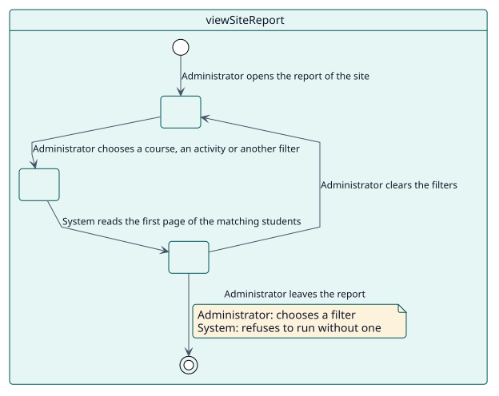
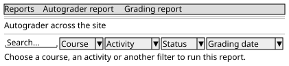

# UC-002 View the report of the site

| Overview | Requirements | Analysis | Design | Implementation | Tests |
| --- | --- | --- | --- | --- | --- |
| [Use cases](../../use-case-overview.svg) | **Requirements** | [Analysis](../../../analysis/use-cases/viewSiteReport/README.md) | [Design](../../../design/use-cases/viewSiteReport/README.md) | [Implementation](../../../implementation/use-cases/viewSiteReport/README.md) | [Tests](../../../implementation/use-cases/viewSiteReport/README.md#tests) |

## Use-case information

| Field | Value |
| --- | --- |
| Actor | Administrator |
| Package | Reading |
| Goal | Check across the site that nothing is stuck. |
| Type | Primary, essential |
| Level | User goal |
| Requirement | RF-002 |
| Domain entities | ReportRow, Scope, Filter, Status |

## Context

An administrator reads the grading of the whole site. Because that would mean asking about every enrolment at once, the report asks for a course, an activity or another filter before it runs.

## Preconditions

- The administrator holds `report/autograder:viewsite`.

## Postconditions

- Success: the table shows the students that match the filter, with the course and the activity of each row.
- Failure: the report asks for a filter and shows no rows.

## Main flow

| Step | Actor | System |
| --- | --- | --- |
| 1 | Opens **Grading report** in the reports of the site. | Checks `report/autograder:viewsite` and shows the filters with no rows. |
| 2 | Chooses a course, an activity or another filter. | Reads the first page of matching rows. |
| 3 |  | Shows the rows with a course column and an activity column. |

## Alternative flows

| ID | Starts at step | Condition | Behaviour | Ends |
| --- | --- | --- | --- | --- |
| A1 | 2 | No filter is chosen. | Explains that a filter is needed and runs nothing. | Step 1 |

## Business rules

| ID | Rule |
| --- | --- |
| RN-002 | The report of the site does not run without a filter. |
| RN-003 | Failures are shown only to readers who can see them. |

## Specification

Behaviour source of truth: [specification.puml](./specification.puml)

## Wireframes

