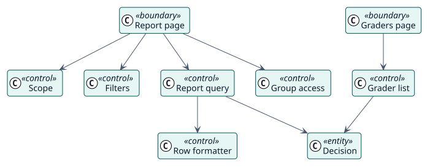

# Análisis

## Clases de análisis

Estereotipos: `<<boundary>>` interfaz, `<<control>>` coordinación, `<<entity>>` información del dominio.

| Clase | Estereotipo | Responsabilidad |
| --- | --- | --- |
| Página del informe, Página de calificadores | frontera | Las pantallas con las que leen docentes y administradores. |
| Ámbito | control | Indica el nivel del informe, su contexto y la capacidad que necesita. |
| Filtros | control | Lee los filtros de la petición y rechaza un informe del sitio sin ninguno. |
| Consulta del informe | control | Lee las filas de una página a partir de las decisiones y del libro de calificaciones. |
| Acceso por grupos | control | Limita las filas a los grupos que el lector puede ver. |
| Formateador de filas | control | Convierte una fila en estado, fecha, calificación y calificador. |
| Lista de calificadores | control | Lista los docentes que podrían calificar un curso y una página de sus estudiantes. |
| Decisión | entidad | La información que almacenó Autograder. |

## Realizaciones de casos de uso

| ID | Caso de uso | Colaboración |
| --- | --- | --- |
| UC-001 | [Ver el informe de una actividad o de un curso](./use-cases/viewReport/README.md) | [colaboración](./use-cases/viewReport/collaboration.svg) |
| UC-002 | [Ver el informe del sitio](./use-cases/viewSiteReport/README.md) | [colaboración](./use-cases/viewSiteReport/collaboration.svg) |
| UC-003 | [Ver quién calificaría cada curso](./use-cases/viewGraders/README.md) | [colaboración](./use-cases/viewGraders/collaboration.svg) |
