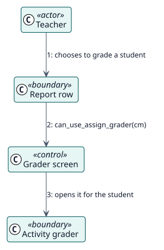

# UC-005 Calificar a un estudiante desde el informe — realización del análisis

| Resumen | Requisitos | Análisis | Diseño | Implementación | Pruebas |
| --- | --- | --- | --- | --- | --- |
| [Casos de uso](../../../requirements/use-case-overview.svg) | [Requisitos](../../../requirements/use-cases/gradeFromReport/README.md) | **Análisis** | [Diseño](../../../design/use-cases/gradeFromReport/README.md) | [Implementación](../../../implementation/use-cases/gradeFromReport/README.md) | [Pruebas](../../../implementation/use-cases/gradeFromReport/README.md#pruebas) |

Requisitos: [README](../../../requirements/use-cases/gradeFromReport/README.md)

## Clases participantes

| Clase | Estereotipo | Responsabilidad |
| --- | --- | --- |
| Fila del informe | frontera | Ofrece la acción de calificar. |
| Pantalla de calificación | control | Decide qué pantalla de calificación tiene la actividad. |
| Calificador de la actividad | frontera | La pantalla de la tarea o del foro. |

## Colaboración

## Notas

Todo lo que la actividad hace cuando un docente califica, como avisar al estudiante, sigue ocurriendo, porque la calificación se da en su propia pantalla.
