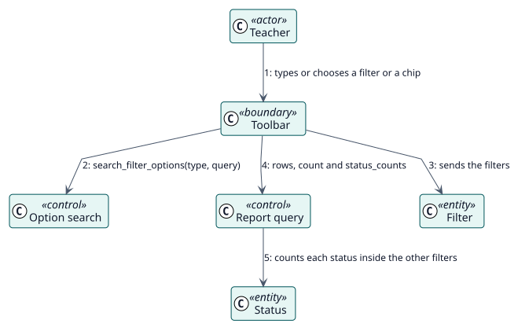

# UC-004 Acotar el informe — realización del análisis

| Resumen | Requisitos | Análisis | Diseño | Implementación | Pruebas |
| --- | --- | --- | --- | --- | --- |
| [Casos de uso](../../../requirements/use-case-overview.svg) | [Requisitos](../../../requirements/use-cases/narrowReport/README.md) | **Análisis** | [Diseño](../../../design/use-cases/narrowReport/README.md) | [Implementación](../../../implementation/use-cases/narrowReport/README.md) | [Pruebas](../../../implementation/use-cases/narrowReport/README.md#pruebas) |

Requisitos: [README](../../../requirements/use-cases/narrowReport/README.md)

## Clases participantes

| Clase | Estereotipo | Responsabilidad |
| --- | --- | --- |
| Barra de herramientas | frontera | Recoge los filtros y el chip elegido. |
| Búsqueda de opciones | control | Enumera los cursos y actividades que el lector puede ver. |
| Consulta del informe | control | Cuenta las filas y cada estado dentro de los filtros. |
| Filtro | entidad | A qué se acota el informe. |
| Estado | entidad | El estado de una decisión tal como el lector puede verlo. |

## Colaboración

## Notas

Los recuentos se piden una vez por cada conjunto de filtros y no se piden de nuevo al cambiar de página.
