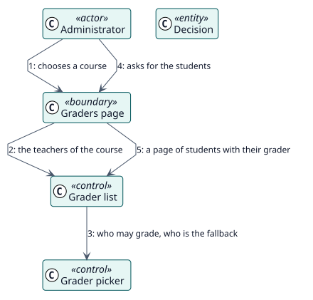

# UC-003 Ver quién calificaría cada curso — realización del análisis

| Resumen | Requisitos | Análisis | Diseño | Implementación | Pruebas |
| --- | --- | --- | --- | --- | --- |
| [Casos de uso](../../../requirements/use-case-overview.svg) | [Requisitos](../../../requirements/use-cases/viewGraders/README.md) | **Análisis** | [Diseño](../../../design/use-cases/viewGraders/README.md) | [Implementación](../../../implementation/use-cases/viewGraders/README.md) | [Pruebas](../../../implementation/use-cases/viewGraders/README.md#pruebas) |

Requisitos: [README](../../../requirements/use-cases/viewGraders/README.md)

## Clases participantes

| Clase | Estereotipo | Responsabilidad |
| --- | --- | --- |
| Página de calificadores | frontera | Dibuja los docentes y los estudiantes. |
| Lista de calificadores | control | Lista los calificadores y una página de estudiantes. |
| Selector de calificador | control | Elige al docente de Autograder. |
| Decisión | entidad | Lo que almacenó Autograder. |

## Colaboración

## Notas

La lista trabaja a partir del curso; el informe de una actividad comprueba esa actividad antes de mostrar el calificador que se aplica.
