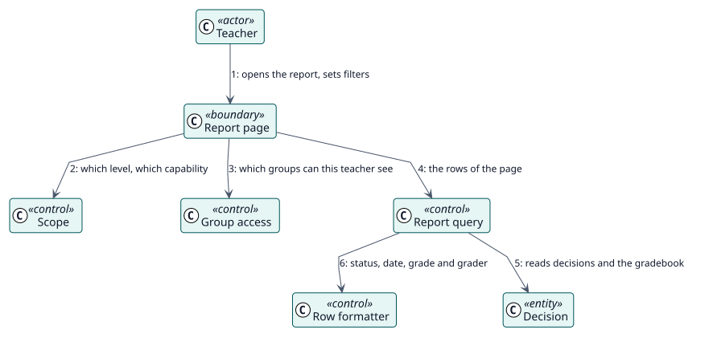

# UC-001 Ver el informe de una actividad o de un curso — realización del análisis

| Resumen | Requisitos | Análisis | Diseño | Implementación | Pruebas |
| --- | --- | --- | --- | --- | --- |
| [Casos de uso](../../../requirements/use-case-overview.svg) | [Requisitos](../../../requirements/use-cases/viewReport/README.md) | **Análisis** | [Diseño](../../../design/use-cases/viewReport/README.md) | [Implementación](../../../implementation/use-cases/viewReport/README.md) | [Pruebas](../../../implementation/use-cases/viewReport/README.md#pruebas) |

Requisitos: [README](../../../requirements/use-cases/viewReport/README.md)

## Clases participantes

| Clase | Estereotipo | Responsabilidad |
| --- | --- | --- |
| Página del informe | frontera | Dibuja la tabla, los filtros y las páginas. |
| Ámbito | control | Indica el nivel, el contexto y la capacidad. |
| Acceso por grupos | control | Limita las filas a los grupos del lector. |
| Consulta del informe | control | Lee las filas de una página. |
| Formateador de filas | control | Construye estado, fecha, calificación y calificador. |
| Decisión | entidad | Lo que almacenó Autograder. |

## Colaboración

## Notas

El informe solo lee. Sus tres funciones de servicio web son de tipo lectura y vuelven a comprobar la capacidad.
