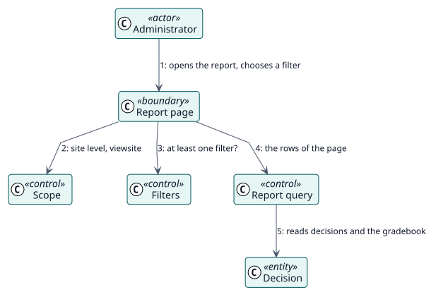

# UC-002 Ver el informe del sitio — realización del análisis

| Resumen | Requisitos | Análisis | Diseño | Implementación | Pruebas |
| --- | --- | --- | --- | --- | --- |
| [Casos de uso](../../../requirements/use-case-overview.svg) | [Requisitos](../../../requirements/use-cases/viewSiteReport/README.md) | **Análisis** | [Diseño](../../../design/use-cases/viewSiteReport/README.md) | [Implementación](../../../implementation/use-cases/viewSiteReport/README.md) | [Pruebas](../../../implementation/use-cases/viewSiteReport/README.md#pruebas) |

Requisitos: [README](../../../requirements/use-cases/viewSiteReport/README.md)

## Clases participantes

| Clase | Estereotipo | Responsabilidad |
| --- | --- | --- |
| Página del informe | frontera | Dibuja los filtros y la tabla. |
| Ámbito | control | Indica el nivel del sitio y su capacidad. |
| Filtros | control | Se niega a ejecutar sin un filtro. |
| Consulta del informe | control | Lee las filas de una página. |
| Decisión | entidad | Lo que almacenó Autograder. |

## Colaboración

## Notas

La barra de filtros ofrece los selectores de curso y de actividad mediante `report_autograder_search_filter_options`.
