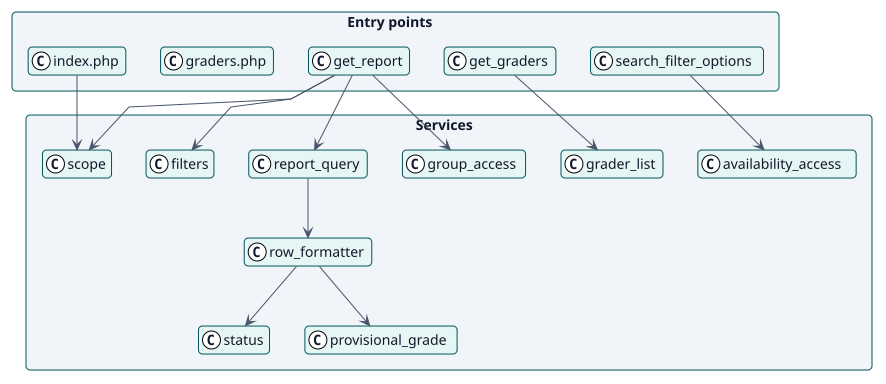
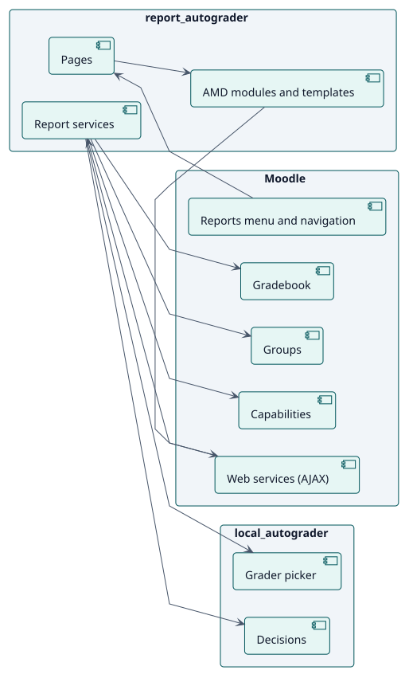
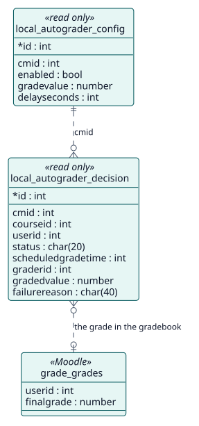

# Diseño

## Arquitectura

El informe de Autograder es un plugin de informe de Moodle con tres capas:

- **Puntos de entrada**: `index.php` y `graders.php`, que dibujan la página, dos funciones de servicio web de solo lectura que alimentan sus módulos AMD, y las plantillas Mustache.
- **Servicios**: clases en `classes/local/`. `scope` y `filters` leen la petición, `report_query` lee las filas, `group_access` las limita, `row_formatter` las convierte en palabras y `grader_list` lista los calificadores de un curso.
- **Persistencia**: ninguna propia. Lee las tablas de Autograder y el libro de calificaciones.

Dos decisiones dan forma al diseño. Primero, **la capacidad se comprueba en cada nivel y de nuevo en cada función de servicio web**, de modo que una página abierta no puede leer más de lo que su lector puede. Segundo, **el informe del sitio nunca se ejecuta sin filtros**, de modo que no puede preguntar por todas las matriculaciones a la vez.

## Clases de diseño

## Componentes

## Modelo de datos

El informe no añade ninguna tabla: el modelo muestra lo que lee.

## Realizaciones de casos de uso

| ID | Caso de uso | Secuencia |
| --- | --- | --- |
| UC-001 | [Ver el informe de una actividad o de un curso](./use-cases/viewReport/README.md) | [secuencia](./use-cases/viewReport/sequence.svg) |
| UC-002 | [Ver el informe del sitio](./use-cases/viewSiteReport/README.md) | [secuencia](./use-cases/viewSiteReport/sequence.svg) |
| UC-003 | [Ver quién calificaría cada curso](./use-cases/viewGraders/README.md) | [secuencia](./use-cases/viewGraders/sequence.svg) |
