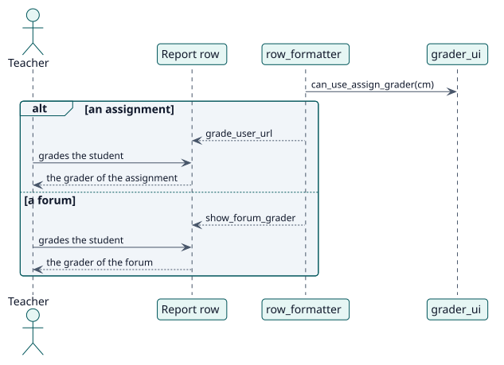

# UC-005 Calificar a un estudiante desde el informe — realización del diseño

| Resumen | Requisitos | Análisis | Diseño | Implementación | Pruebas |
| --- | --- | --- | --- | --- | --- |
| [Casos de uso](../../../requirements/use-case-overview.svg) | [Requisitos](../../../requirements/use-cases/gradeFromReport/README.md) | [Análisis](../../../analysis/use-cases/gradeFromReport/README.md) | **Diseño** | [Implementación](../../../implementation/use-cases/gradeFromReport/README.md) | [Pruebas](../../../implementation/use-cases/gradeFromReport/README.md#pruebas) |

Análisis: [README](../../../analysis/use-cases/gradeFromReport/README.md)

## Elementos

| Elemento de diseño | Tipo | Código |
| --- | --- | --- |
| `grader_ui::can_use_assign_grader` | servicio | `classes/local/page/grader_ui.php:94` |
| `grader_ui::get_forum_grade_context` | servicio | `classes/local/page/grader_ui.php:52` |
| `row_formatter::add_grading_action` | servicio | `classes/local/format/row_formatter.php` |

## Secuencia

## Contratos

| Operación | Entrada | Salida | Errores |
| --- | --- | --- | --- |
| `get_report` row | la actividad y el estudiante | `grade_user_url` o `show_forum_grader` | ninguno |

## Datos que toca

| Tabla o entidad | Operación |
| --- | --- |
| No table | ninguna: solo traspasa |
