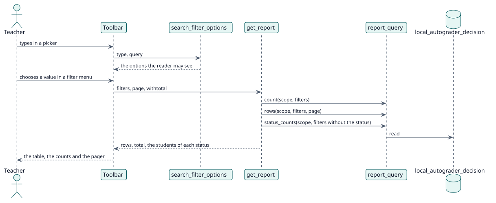

# UC-004 Acotar el informe — realización del diseño

| Resumen | Requisitos | Análisis | Diseño | Implementación | Pruebas |
| --- | --- | --- | --- | --- | --- |
| [Casos de uso](../../../requirements/use-case-overview.svg) | [Requisitos](../../../requirements/use-cases/narrowReport/README.md) | [Análisis](../../../analysis/use-cases/narrowReport/README.md) | **Diseño** | [Implementación](../../../implementation/use-cases/narrowReport/README.md) | [Pruebas](../../../implementation/use-cases/narrowReport/README.md#pruebas) |

Análisis: [README](../../../analysis/use-cases/narrowReport/README.md)

## Elementos

| Elemento de diseño | Tipo | Código |
| --- | --- | --- |
| `get_report::execute` | servicio web | `classes/external/get_report.php:93` |
| `filters::from_request` | servicio | `classes/local/query/filters.php:63` |
| `filters::without_statuses` | servicio | `classes/local/query/filters.php:172` |
| `report_query::status_counts` | servicio | `classes/local/query/report_query.php:77` |
| `search_filter_options::execute` | servicio web | `classes/external/search_filter_options.php:109` |
| `page_context::filters` | servicio | `classes/local/page/page_context.php:51` |

## Secuencia

## Contratos

| Operación | Entrada | Salida | Errores |
| --- | --- | --- | --- |
| `report_autograder_search_filter_options(type, query, cmid, courseid, filtercourseid)` | lo que se busca y el informe al que pertenece | hasta treinta opciones | sin capacidad |
| `report_autograder_get_report(..., filters, withtotal)` | los filtros | las filas, el total y `statuscounts` | sin capacidad, filtro no válido |

## Datos que toca

| Tabla o entidad | Operación |
| --- | --- |
| `local_autograder_decision` | lectura |
| `local_autograder_config` | lectura |
