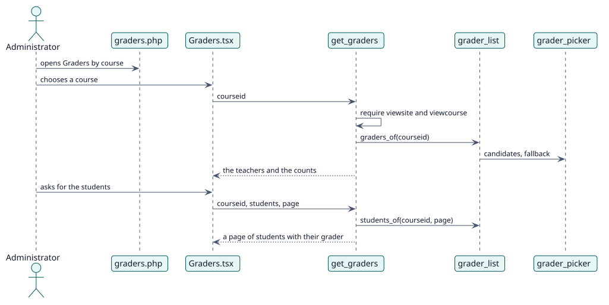

# UC-003 Ver quién calificaría cada curso — realización del diseño

| Resumen | Requisitos | Análisis | Diseño | Implementación | Pruebas |
| --- | --- | --- | --- | --- | --- |
| [Casos de uso](../../../requirements/use-case-overview.svg) | [Requisitos](../../../requirements/use-cases/viewGraders/README.md) | [Análisis](../../../analysis/use-cases/viewGraders/README.md) | **Diseño** | [Implementación](../../../implementation/use-cases/viewGraders/README.md) | [Pruebas](../../../implementation/use-cases/viewGraders/README.md#pruebas) |

Análisis: [README](../../../analysis/use-cases/viewGraders/README.md)

## Elementos

| Elemento de diseño | Tipo | Código |
| --- | --- | --- |
| `get_graders::execute` | servicio | `classes/external/get_graders.php:63` |
| `grader_list::graders_of` | servicio | `classes/local/page/grader_list.php:66` |
| `grader_list::students_of` | servicio | `classes/local/page/grader_list.php:103` |

## Secuencia

## Contratos

| Operación | Entrada | Salida | Errores |
| --- | --- | --- | --- |
| `report_autograder_get_graders(courseid, students, page, perpage)` | el curso y, si se pide, una página de estudiantes | los calificadores, los recuentos y los estudiantes | sin capacidad, curso no encontrado |

## Datos que toca

| Tabla o entidad | Operación |
| --- | --- |
| `local_autograder_decision` | lectura |
| `user_enrolments` | lectura |
