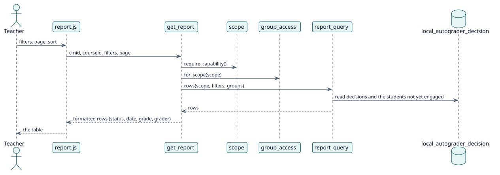

# UC-001 Ver el informe de una actividad o de un curso — realización del diseño

| Resumen | Requisitos | Análisis | Diseño | Implementación | Pruebas |
| --- | --- | --- | --- | --- | --- |
| [Casos de uso](../../../requirements/use-case-overview.svg) | [Requisitos](../../../requirements/use-cases/viewReport/README.md) | [Análisis](../../../analysis/use-cases/viewReport/README.md) | **Diseño** | [Implementación](../../../implementation/use-cases/viewReport/README.md) | [Pruebas](../../../implementation/use-cases/viewReport/README.md#pruebas) |

Análisis: [README](../../../analysis/use-cases/viewReport/README.md)

## Elementos

| Elemento de diseño | Tipo | Código |
| --- | --- | --- |
| `get_report::execute` | servicio | `classes/external/get_report.php:93` |
| `scope::require_capability` | servicio | `classes/local/query/scope.php:160` |
| `report_query::rows` | servicio | `classes/local/query/report_query.php:106` |
| `report_query::status_counts` | servicio | `classes/local/query/report_query.php:77` |
| `group_access::for_scope` | servicio | `classes/local/groups/group_access.php:100` |
| `status::from_decision` | servicio | `classes/local/format/status.php:64` |

## Secuencia

## Contratos

| Operación | Entrada | Salida | Errores |
| --- | --- | --- | --- |
| `report_autograder_get_report(cmid, courseid, page, limit, filters, sortcolumn, sortdir, withtotal)` | el nivel, los filtros, la página y el orden | una página de filas formateadas, el total y los estudiantes de cada estado | sin capacidad, filtro no válido |

## Datos que toca

| Tabla o entidad | Operación |
| --- | --- |
| `local_autograder_decision` | lectura |
| `local_autograder_config` | lectura |
| `grade_grades` | lectura |
