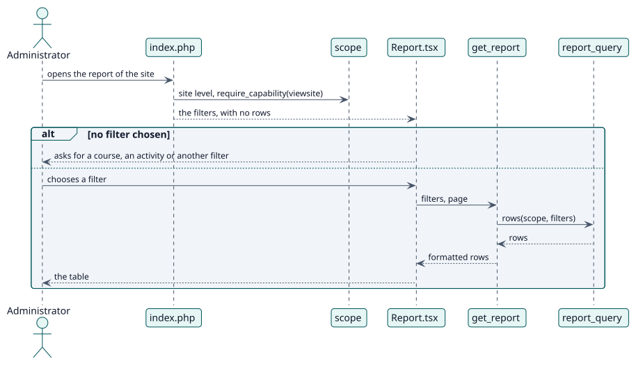

# UC-002 Ver el informe del sitio — realización del diseño

| Resumen | Requisitos | Análisis | Diseño | Implementación | Pruebas |
| --- | --- | --- | --- | --- | --- |
| [Casos de uso](../../../requirements/use-case-overview.svg) | [Requisitos](../../../requirements/use-cases/viewSiteReport/README.md) | [Análisis](../../../analysis/use-cases/viewSiteReport/README.md) | **Diseño** | [Implementación](../../../implementation/use-cases/viewSiteReport/README.md) | [Pruebas](../../../implementation/use-cases/viewSiteReport/README.md#pruebas) |

Análisis: [README](../../../analysis/use-cases/viewSiteReport/README.md)

## Elementos

| Elemento de diseño | Tipo | Código |
| --- | --- | --- |
| `scope::from_params` | servicio | `classes/local/query/scope.php:77` |
| `filters` | servicio | `classes/local/query/filters.php` |
| `search_filter_options::execute` | servicio | `classes/external/search_filter_options.php:109` |

## Secuencia

## Contratos

| Operación | Entrada | Salida | Errores |
| --- | --- | --- | --- |
| `report_autograder_search_filter_options(type, query, cmid, courseid, filtercourseid)` | el tipo de selector y lo que escribió el lector | los cursos o actividades que coinciden | sin capacidad |

## Datos que toca

| Tabla o entidad | Operación |
| --- | --- |
| `local_autograder_decision` | lectura |
| `course` | lectura (el selector) |
