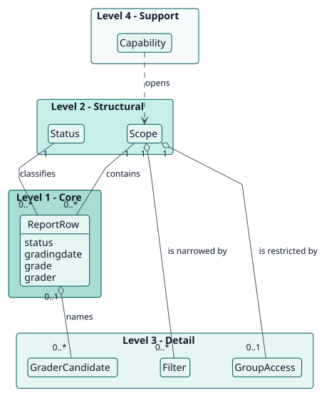
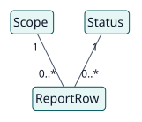
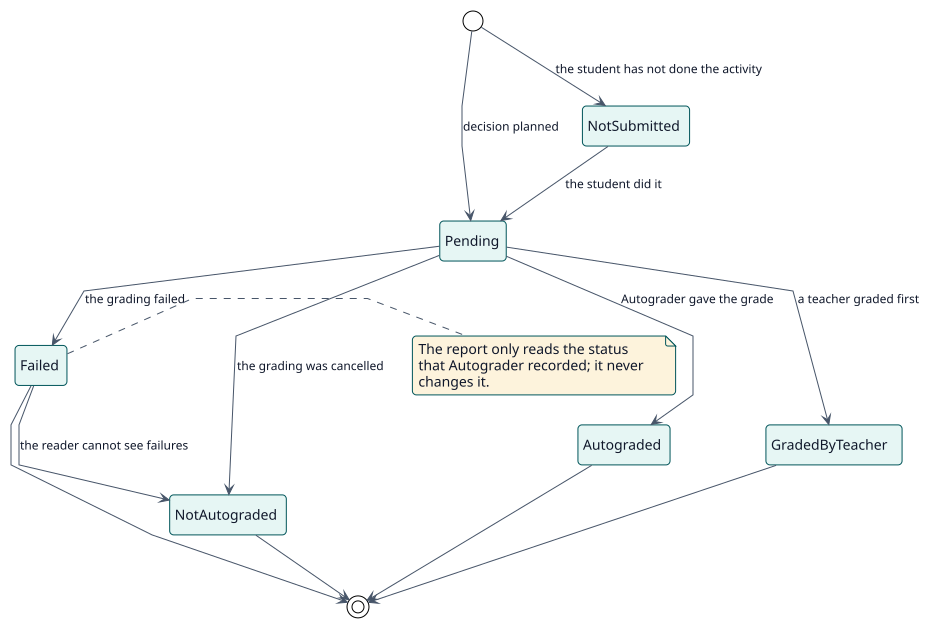

# Modelo de dominio

## Propósito

Autograder decide y califica; este plugin permite ver lo que se decidió. Su modelo nombra lo que ve un lector: una fila por estudiante y actividad autocalificada, el nivel en el que la lee y el estado que clasifica cada fila.

## Jerarquía de entidades

La posición vertical de una entidad expresa su importancia para el objetivo del proyecto. No es herencia ni composición UML.

| Nivel | Significado | Entidades | Por qué están aquí |
| --- | --- | --- | --- |
| 1 | Núcleo: el proyecto no puede existir sin ellas | ReportRow | El plugin existe para mostrar, para un estudiante y una actividad, el estado, la fecha, la calificación y el calificador. |
| 2 | Estructurales: dependen directamente del núcleo | Scope, Status | Una fila pertenece a un nivel de lectura y tiene un estado. |
| 3 | Detalle: cualifican o especializan el nivel 2 | Filter, GroupAccess, GraderCandidate | Acotan lo que ve un lector y nombran quién calificaría. |
| 4 | Soporte: catálogos, auditoría, configuración | Capability | Decide quién puede leer cada nivel. |

## Diagramas

## Diccionario de entidades

| Entidad | Nivel | Definición | Atributos clave | Atributos omitidos y motivo |
| --- | --- | --- | --- | --- |
| ReportRow | 1 | Un estudiante en una actividad autocalificada, tal como lo ve el lector. | estado, fecha de calificación, calificación, calificador | No se almacena: se construye a partir de las decisiones de Autograder y del libro de calificaciones. |
| Scope | 2 | El nivel en el que se lee el informe: actividad, curso o sitio. | nivel, actividad, curso | Se calcula a partir de la dirección de la página. |
| Status | 2 | Lo que dice la fila sobre el estudiante: pendiente, autocalificado, calificado por un docente, con error, no autocalificado o sin entregar. | el estado | Es el estado que registró Autograder, traducido a palabras para los docentes. |
| Filter | 3 | Una restricción de la tabla: un texto de búsqueda, un periodo, estados, un curso, una actividad o un grupo. | nombre, valor | |
| GroupAccess | 3 | Los grupos que un docente puede ver en una actividad con grupos separados. | ids de grupo | Sigue las reglas de grupos de Moodle. |
| GraderCandidate | 3 | Un docente que podría calificar un curso, o el calificador de reserva. | usuario de Moodle | Lo calcula Autograder. |
| Capability | 4 | El permiso para leer un nivel o para ver los fallos. | la capacidad | Están definidas en `db/access.php`. |

## Reglas de negocio

| ID | Regla | Entidades | Fuente |
| --- | --- | --- | --- |
| RN-001 | Hay una fila por estudiante y actividad autocalificada; un estudiante que no ha hecho la actividad aparece como sin entregar. | ReportRow, Status | `report_query::rows` |
| RN-002 | El informe del sitio no se ejecuta sin un filtro, de modo que nunca pregunta por todas las matriculaciones del sitio a la vez. | Scope, Filter | `classes/local/query/filters.php` |
| RN-003 | Las calificaciones fallidas y sus motivos solo se muestran a los lectores que pueden ver los fallos; los demás ven a esos estudiantes como no autocalificados. | Status, Capability | `status::from_decision`, `scope::can_see_failures` |
| RN-004 | Un docente ve solo a los estudiantes de los grupos que puede ver en la actividad. | GroupAccess | `group_access::for_scope` |
| RN-005 | Una fila pendiente muestra la calificación que recibiría el estudiante y el docente que la firmaría si se diera ahora. | ReportRow, GraderCandidate | `provisional_grade::for_row` |
| RN-006 | El informe solo lee: nunca califica, cancela ni cambia una decisión. | todas | servicios web de solo lectura |
| RN-007 | Un estudiante al que las restricciones de acceso de la actividad dejan fuera no se enumera como sin entregar: no puede abrir la actividad, de modo que el informe no dice nada de él. | ReportRow, Scope | `availability_access::for_scope` |
| RN-008 | El recuento de cada estado se calcula dentro de todos los demás filtros salvo el propio estado, de modo que elegir un estado no oculte los números de los demás. | Filter, Status | `report_query::status_counts` |
| RN-009 | El paginador ofrece solo los tamaños de página menores que la lista, y Todos: hasta 12 filas, Todos; de 13 a 24, 12 y Todos; y así hasta 12, 24, 48, 96 y Todos. Una lista empieza con 12 filas; Todos se envía a los servicios como -1, que estos limitan. | Filter | `amd/src/ui/pagination.js`, `get_report::normalise_limit`, `grader_list::page_size` |
| RN-010 | Cada filtro es un menú que nunca ofrece su estado base como opción; al elegir un valor, el menú se resalta y una cruz ocupa el lugar de su flecha para quitarlo. Un botón al final de la fila quita todos los filtros. | Filter | `amd/src/ui/toolbar.js` |
| RN-011 | La primera vez que una persona abre el informe de una actividad o de un curso, un recorrido guiado lo presenta; cuando el sitio lo exige, el recorrido no puede omitirse antes de su último paso. | Scope | `tours/report.json`, `report_autograder_import_tours`, `report_autograder/tourrequired` |
| RN-012 | El botón que abre el detalle de una fila toma el color de lo más grave que contiene: información, un problema que aún puede resolverse o una calificación con error. Una calificación que aún no está en el libro de calificaciones lleva la etiqueta Provisional, y una fila sin calificación muestra un guion. | ReportRow | `templates/table/_row.mustache`, `templates/table/row_details.mustache`, `amd/src/ui/report.js` |
| RN-013 | Las columnas de la tabla conservan el ancho que tenían la primera vez que la tabla tuvo filas; un filtro, una ordenación u otra página nunca las mueven. Se miden de nuevo solo cuando cambia el ancho del recuadro de la tabla. | ReportRow | `amd/src/ui/report.js` |
| RN-014 | La fila de filtros nunca se divide en dos líneas: cuando los menús no caben junto a la búsqueda (10 rem), se reúnen en un único menú, Filtros, con el número de filtros en uso, y se separan de nuevo cuando hay espacio. | Filter | `amd/src/ui/toolbar.js` |

## Ciclos de vida

### Estado de una fila

