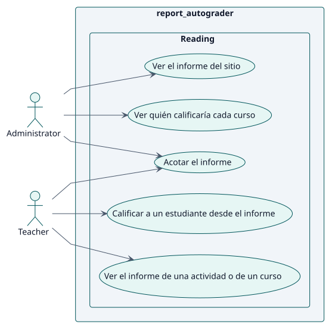
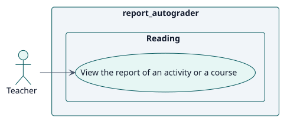
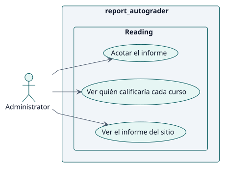

# Requisitos

## Índice

- [Actores](./actors.md)
- [Catálogo de requisitos](./requirements.md)

## Casos de uso

| ID | Caso de uso | Actor | Paquete | Requisito | Análisis | Diseño | Implementación | Estado |
| --- | --- | --- | --- | --- | --- | --- | --- | --- |
| UC-001 | [Ver el informe de una actividad o de un curso](./use-cases/viewReport/README.md) | Docente | Lectura | RF-001 | [ficha](../analysis/use-cases/viewReport/README.md) | [ficha](../design/use-cases/viewReport/README.md) | [ficha](../implementation/use-cases/viewReport/README.md) | borrador |
| UC-002 | [Ver el informe del sitio](./use-cases/viewSiteReport/README.md) | Administrador | Lectura | RF-002 | [ficha](../analysis/use-cases/viewSiteReport/README.md) | [ficha](../design/use-cases/viewSiteReport/README.md) | [ficha](../implementation/use-cases/viewSiteReport/README.md) | borrador |
| UC-003 | [Ver quién calificaría cada curso](./use-cases/viewGraders/README.md) | Administrador | Lectura | RF-003 | [ficha](../analysis/use-cases/viewGraders/README.md) | [ficha](../design/use-cases/viewGraders/README.md) | [ficha](../implementation/use-cases/viewGraders/README.md) | borrador |
| UC-004 | [Acotar el informe](./use-cases/narrowReport/README.md) | Docente, Administrador | Lectura | RF-005 | [ficha](../analysis/use-cases/narrowReport/README.md) | [ficha](../design/use-cases/narrowReport/README.md) | [ficha](../implementation/use-cases/narrowReport/README.md) | borrador |
| UC-005 | [Calificar a un estudiante desde el informe](./use-cases/gradeFromReport/README.md) | Docente | Lectura | RF-006 | [ficha](../analysis/use-cases/gradeFromReport/README.md) | [ficha](../design/use-cases/gradeFromReport/README.md) | [ficha](../implementation/use-cases/gradeFromReport/README.md) | borrador |

### Diagrama de casos de uso

### Por actor

#### Docente

#### Administrador

