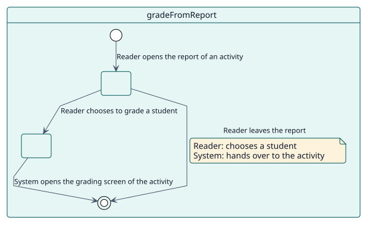
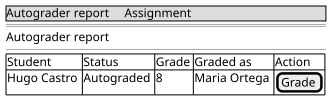

# UC-005 Calificar a un estudiante desde el informe

| Resumen | Requisitos | Análisis | Diseño | Implementación | Pruebas |
| --- | --- | --- | --- | --- | --- |
| [Casos de uso](../../use-case-overview.svg) | **Requisitos** | [Análisis](../../../analysis/use-cases/gradeFromReport/README.md) | [Diseño](../../../design/use-cases/gradeFromReport/README.md) | [Implementación](../../../implementation/use-cases/gradeFromReport/README.md) | [Pruebas](../../../implementation/use-cases/gradeFromReport/README.md#pruebas) |

## Información del caso de uso

| Campo | Valor |
| --- | --- |
| Actor | Docente |
| Paquete | Reading |
| Objetivo | Pasar de una fila del informe a la pantalla de calificación que la actividad ya tiene para ese estudiante. |
| Tipo | Primario, esencial |
| Nivel | Objetivo de usuario |
| Requisito | RF-006 |
| Entidades del dominio | ReportRow, Scope |

## Contexto

El informe nunca califica. Cuando un docente quiere calificar a un estudiante que está viendo, la fila lo envía a la pantalla de la actividad, de modo que todo lo que la actividad hace en torno a una calificación siga ocurriendo.

## Precondiciones

- El lector abrió el informe de una actividad, que es una tarea o un foro.

## Postcondiciones

- Éxito: la pantalla de calificación de la actividad se abre sobre ese estudiante.
- Fallo: la fila no ofrece ninguna acción de calificación.

## Flujo principal

| Paso | Actor | Sistema |
| --- | --- | --- |
| 1 | Abre el informe de una actividad. | Da a cada fila la forma de calificar que permite el tipo de la actividad. |
| 2 | Elige calificar al estudiante de una fila. | Para una tarea, va a su calificador por dirección; para un foro, abre el calificador del foro. |

## Flujos alternativos

| ID | Empieza en el paso | Condición | Comportamiento | Termina |
| --- | --- | --- | --- | --- |
| A1 | 1 | El informe es el de un curso o el del sitio. | No ofrece ninguna acción de calificación: las pantallas se lanzan desde el informe de la actividad. | Fin |
| A2 | 1 | La actividad es de otro tipo. | No ofrece ninguna acción de calificación. | Fin |

## Reglas de negocio

| ID | Regla |
| --- | --- |
| RN-006 | El informe solo lee: nunca califica, cancela ni cambia una decisión. |

## Especificación

Fuente de verdad del comportamiento: [specification.puml](./specification.puml)

## Prototipos

