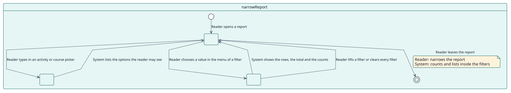
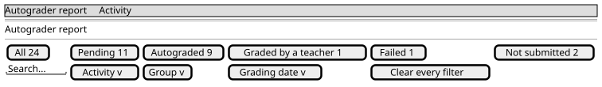

# UC-004 Acotar el informe

| Resumen | Requisitos | Análisis | Diseño | Implementación | Pruebas |
| --- | --- | --- | --- | --- | --- |
| [Casos de uso](../../use-case-overview.svg) | **Requisitos** | [Análisis](../../../analysis/use-cases/narrowReport/README.md) | [Diseño](../../../design/use-cases/narrowReport/README.md) | [Implementación](../../../implementation/use-cases/narrowReport/README.md) | [Pruebas](../../../implementation/use-cases/narrowReport/README.md#pruebas) |

## Información del caso de uso

| Campo | Valor |
| --- | --- |
| Actor | Docente, Administrador |
| Paquete | Reading |
| Objetivo | Encontrar en el informe a los estudiantes que importan por nombre, estado, grupo, fecha de calificación, actividad o curso. |
| Tipo | Primario, esencial |
| Nivel | Objetivo de usuario |
| Requisito | RF-005 |
| Entidades del dominio | Filter, Status, ReportRow, GroupAccess |

## Contexto

Un informe puede enumerar miles de filas. La barra de herramientas lo acota, y los chips de los estados indican cuántos estudiantes hay en cada estado, contados dentro de todos los demás filtros, de modo que los números suman las filas que mostraría el informe.

## Precondiciones

- El lector ha abierto un informe y tiene su capacidad.

## Postcondiciones

- Éxito: la tabla muestra a los estudiantes que coinciden, con el total y el número de cada estado.
- Fallo: un filtro no válido se ignora y el informe conserva lo que mostraba.

## Flujo principal

| Paso | Actor | Sistema |
| --- | --- | --- |
| 1 | Escribe un nombre, o elige un chip de estado, un grupo, un periodo de fechas de calificación, una actividad o un curso. | Para la actividad y el curso, busca las opciones mientras se escribe, entre las que el lector puede ver. |
| 2 |  | Pide de nuevo la primera página con los filtros, el total y los estudiantes de cada estado. |
| 3 |  | Muestra las filas, el total y los chips, y marca los chips y filtros activos. |
| 4 | Vuelve a pulsar un chip, o **Limpiar todos los filtros**. | Levanta el filtro y muestra el informe como estaba. |

## Flujos alternativos

| ID | Empieza en el paso | Condición | Comportamiento | Termina |
| --- | --- | --- | --- | --- |
| A1 | 2 | El informe es el del sitio y el lector no lo ha acotado. | Pide un filtro antes de ejecutarse. | Paso 1 |
| A2 | 2 | El lector no puede ver los fallos. | No ofrece el chip de los estudiantes con error y los cuenta como no autocalificados. | Paso 3 |
| A3 | 3 | Un estado no tiene estudiantes. | No ofrece su chip, salvo que sea el elegido. | Paso 4 |

## Reglas de negocio

| ID | Regla |
| --- | --- |
| RN-008 | El recuento de cada estado se calcula dentro de todos los demás filtros salvo el propio estado, de modo que elegir un estado no oculte los números de los demás. |
| RN-002 | El informe del sitio no se ejecuta sin un filtro. |
| RN-003 | Los fallos se muestran solo a los lectores que pueden verlos. |
| RN-004 | Un docente ve solo los grupos que puede ver. |

## Especificación

Fuente de verdad del comportamiento: [specification.puml](./specification.puml)

## Prototipos

