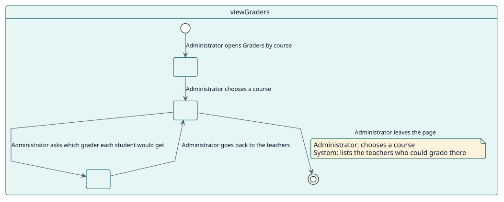
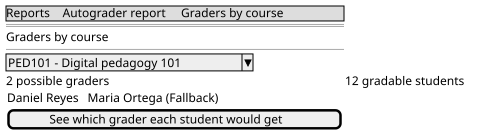

# UC-003 Ver quién calificaría cada curso

| Resumen | Requisitos | Análisis | Diseño | Implementación | Pruebas |
| --- | --- | --- | --- | --- | --- |
| [Casos de uso](../../use-case-overview.svg) | **Requisitos** | [Análisis](../../../analysis/use-cases/viewGraders/README.md) | [Diseño](../../../design/use-cases/viewGraders/README.md) | [Implementación](../../../implementation/use-cases/viewGraders/README.md) | [Pruebas](../../../implementation/use-cases/viewGraders/README.md#pruebas) |

## Información del caso de uso

| Campo | Valor |
| --- | --- |
| Actor | Administrador |
| Paquete | Reading |
| Objetivo | Saber, antes de que venza ninguna calificación, qué docente calificaría a cada estudiante de un curso. |
| Tipo | Primario, esencial |
| Nivel | Objetivo de usuario |
| Requisito | RF-003 |
| Entidades del dominio | GraderCandidate, ReportRow, Scope |

## Contexto

Un curso donde nadie puede calificar fallaría todas las calificaciones cuando llegue su fecha. La página de calificadores muestra quién podría calificar allí, de modo que pueda corregirse con antelación.

## Precondiciones

- El administrador tiene `report/autograder:viewsite`, y `report/autograder:viewcourse` en el curso.

## Postcondiciones

- Éxito: se listan los docentes que podrían calificar, con el calificador de reserva, y una página de estudiantes muestra el calificador que tendría cada uno.
- Fallo: la página se niega a mostrar un curso que el administrador no puede leer.

## Flujo principal

| Paso | Actor | Sistema |
| --- | --- | --- |
| 1 | Abre **Calificadores por curso** y elige un curso. | Comprueba la capacidad del menú y, en el curso, `report/autograder:viewcourse`. |
| 2 |  | Lista los docentes que podrían calificar allí y los cuenta, igual que a los estudiantes. |
| 3 | Pide qué calificador tendría cada estudiante. | Lee una página de estudiantes con el docente elegido para cada uno. |

## Flujos alternativos

| ID | Empieza en el paso | Condición | Comportamiento | Termina |
| --- | --- | --- | --- | --- |
| A1 | 2 | Nadie podría calificar en el curso. | Señala el curso; todas las calificaciones allí fallarían sin un calificador de reserva. | Paso 3 |

## Reglas de negocio

| ID | Regla |
| --- | --- |
| RN-005 | Una fila muestra el docente que firmaría la calificación si se diera ahora. |
| RN-006 | La página solo lee. |

## Especificación

Fuente de verdad del comportamiento: [specification.puml](./specification.puml)

## Prototipos

