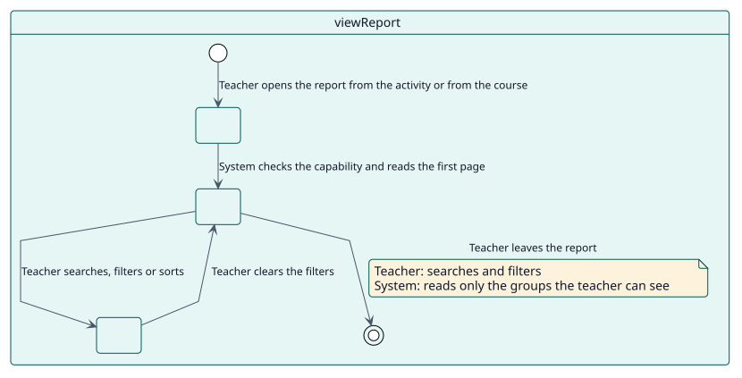
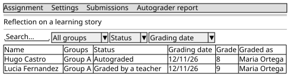

# UC-001 Ver el informe de una actividad o de un curso

| Resumen | Requisitos | Análisis | Diseño | Implementación | Pruebas |
| --- | --- | --- | --- | --- | --- |
| [Casos de uso](../../use-case-overview.svg) | **Requisitos** | [Análisis](../../../analysis/use-cases/viewReport/README.md) | [Diseño](../../../design/use-cases/viewReport/README.md) | [Implementación](../../../implementation/use-cases/viewReport/README.md) | [Pruebas](../../../implementation/use-cases/viewReport/README.md#pruebas) |

## Información del caso de uso

| Campo | Valor |
| --- | --- |
| Actor | Docente |
| Paquete | Reading |
| Objetivo | Seguir a los estudiantes de una actividad o de un curso y saber quién espera. |
| Tipo | Primario, esencial |
| Nivel | Objetivo de usuario |
| Requisito | RF-001 |
| Entidades del dominio | ReportRow, Scope, Status, Filter, GroupAccess |

## Contexto

Un docente necesita ver, para cada estudiante, lo que Autograder decidió: el estado, la fecha de calificación, la calificación y quién la firma. El informe aparece donde el docente ya trabaja, en el menú de la actividad o del curso.

## Precondiciones

- El docente tiene `report/autograder:view` en la actividad, o `report/autograder:viewcourse` en el curso.
- Autograder está activado en la actividad, o en al menos una actividad del curso.

## Postcondiciones

- Éxito: la tabla muestra a los estudiantes que el docente puede ver, acotados por lo que eligió.
- Fallo: la página se niega a abrirse sin la capacidad.

## Flujo principal

| Paso | Actor | Sistema |
| --- | --- | --- |
| 1 | Abre **Informe de Autograder** en el menú de la actividad o del curso. | Comprueba la capacidad del nivel. |
| 2 |  | Lee la primera página de filas, limitada a los grupos que el docente puede ver. |
| 3 | Busca, filtra u ordena. | Vuelve a leer la página con los nuevos filtros. |
| 4 |  | Muestra cada fila con su estado, fecha, calificación y calificador; una fila pendiente muestra la calificación y el docente que tendría ahora. |

## Flujos alternativos

| ID | Empieza en el paso | Condición | Comportamiento | Termina |
| --- | --- | --- | --- | --- |
| A1 | 1 | El docente no tiene la capacidad. | Rechaza la página. | Fin |
| A2 | 2 | La actividad tiene grupos separados. | Deja fuera a los estudiantes de los grupos que el docente no puede ver. | Paso 3 |
| A3 | 4 | El lector no puede ver los fallos. | Muestra a un estudiante con error como no autocalificado. | Paso 3 |

## Reglas de negocio

| ID | Regla |
| --- | --- |
| RN-001 | Hay una fila por estudiante y actividad autocalificada. |
| RN-003 | Los fallos se muestran solo a los lectores que pueden verlos. |
| RN-004 | Un docente ve solo los grupos que puede ver. |
| RN-005 | Una fila pendiente muestra la calificación y el calificador provisionales. |

## Especificación

Fuente de verdad del comportamiento: [specification.puml](./specification.puml)

## Prototipos

