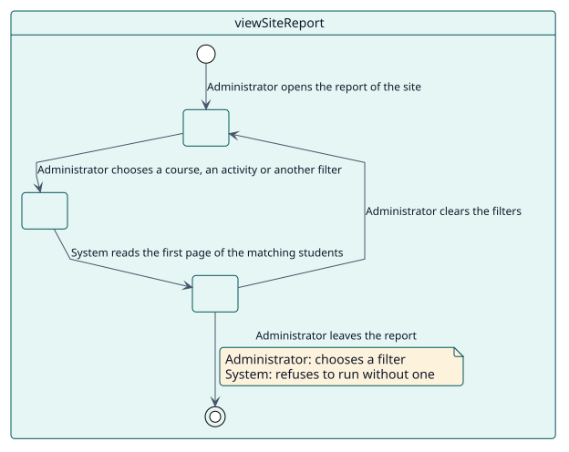
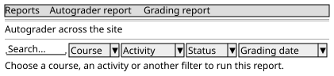

# UC-002 Ver el informe del sitio

| Resumen | Requisitos | Análisis | Diseño | Implementación | Pruebas |
| --- | --- | --- | --- | --- | --- |
| [Casos de uso](../../use-case-overview.svg) | **Requisitos** | [Análisis](../../../analysis/use-cases/viewSiteReport/README.md) | [Diseño](../../../design/use-cases/viewSiteReport/README.md) | [Implementación](../../../implementation/use-cases/viewSiteReport/README.md) | [Pruebas](../../../implementation/use-cases/viewSiteReport/README.md#pruebas) |

## Información del caso de uso

| Campo | Valor |
| --- | --- |
| Actor | Administrador |
| Paquete | Reading |
| Objetivo | Comprobar en todo el sitio que nada está bloqueado. |
| Tipo | Primario, esencial |
| Nivel | Objetivo de usuario |
| Requisito | RF-002 |
| Entidades del dominio | ReportRow, Scope, Filter, Status |

## Contexto

Un administrador lee la calificación de todo el sitio. Como eso supondría preguntar por todas las matriculaciones a la vez, el informe pide un curso, una actividad u otro filtro antes de ejecutarse.

## Precondiciones

- El administrador tiene `report/autograder:viewsite`.

## Postcondiciones

- Éxito: la tabla muestra a los estudiantes que coinciden con el filtro, con el curso y la actividad de cada fila.
- Fallo: el informe pide un filtro y no muestra filas.

## Flujo principal

| Paso | Actor | Sistema |
| --- | --- | --- |
| 1 | Abre **Informe de calificación** en los informes del sitio. | Comprueba `report/autograder:viewsite` y muestra los filtros sin filas. |
| 2 | Elige un curso, una actividad u otro filtro. | Lee la primera página de filas que coinciden. |
| 3 |  | Muestra las filas con una columna de curso y otra de actividad. |

## Flujos alternativos

| ID | Empieza en el paso | Condición | Comportamiento | Termina |
| --- | --- | --- | --- | --- |
| A1 | 2 | No se elige ningún filtro. | Explica que hace falta un filtro y no ejecuta nada. | Paso 1 |

## Reglas de negocio

| ID | Regla |
| --- | --- |
| RN-002 | El informe del sitio no se ejecuta sin un filtro. |
| RN-003 | Los fallos se muestran solo a los lectores que pueden verlos. |

## Especificación

Fuente de verdad del comportamiento: [specification.puml](./specification.puml)

## Prototipos

